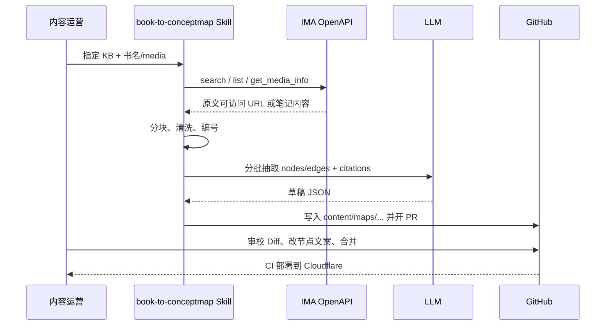

# 概念地图生成器 — 产品设计文档

> 版本：0.1（需求对齐稿）  
> 日期：2026-10-09（CST）  
> 状态：待用户确认开放问题后进入实现

---

## 1. 问题陈述

读书与知识沉淀时，常见痛点是：

- 书本内容在 IMA 知识库中以整本/整文件存在，难以按**概念**浏览与关联；
- 线性阅读无法呈现「概念 ↔ 概念」「概念 ↔ 论据」的网状结构；
- 人工整理概念图成本高，且缺少与原文的可追溯引用。

本产品要把 **IMA 知识库中的某本书**，系统化拆解为可交互的**概念地图**（节点 + 关系边），并在 Web 上阅读、在 GitHub 上版本化维护、在 Cloudflare 上部署。

---

## 2. 目标与非目标

### 2.1 目标（Goals）

| ID | 目标 | 来源 |
|----|------|------|
| G1 | 从 IMA 知识库拉取指定书籍原文，做细粒度拆解 | **用户明确要求** |
| G2 | 生成相互关联的概念地图节点；节点详情含基于原文的概念内容 | **用户明确要求** |
| G3 | 工程代码与概念地图内容共同维护在 GitHub 仓库 | **用户明确要求** |
| G4 | Web 页面展示概念地图，部署于 Cloudflare | **用户明确要求** |
| G5 | 「书 → 结构化节点/边」流程封装为可复用 Skill | **用户明确要求** |
| G6 | 每条节点/边尽量可追溯到原文片段（引用/页码/段落） | **提议补充** |
| G7 | AI 出草稿 + 人工审校 + 发布的闭环 | **提议补充** |

### 2.2 非目标（Non-Goals）— 第一版不做

| ID | 非目标 | 说明 |
|----|--------|------|
| N1 | 实时多人协同编辑（Figma 式） | 第一版用 Git PR 审校即可 |
| N2 | 通用知识图谱数据库（Neo4j 等） | 内容以仓库内 JSON/Markdown 为准 |
| N3 | 面向公众的账号体系 / 付费 | 默认可公开只读；编辑在本地/Agent 侧完成 |
| N4 | 自动覆盖 IMA 原文或回写修改到书文件 | 地图是派生制品，原文只读 |
| N5 | 超大规模图（>5k 可见节点）的 WebGL 可视化 | 单书概念图预期数百～一两千节点 |
| N6 | 完整 OCR / 扫描书排版还原 | 依赖 IMA 已解析可读文本；扫描件需另议 |

---

## 3. 角色与权限

| 角色 | 说明 | 来源 |
|------|------|------|
| **内容运营（Content Operator）** | 指定书目、触发 Skill 抽取、审校节点/边、提交 Git、触发部署 | **提议补充** |
| **读者（Reader）** | 打开已发布站点，浏览图、点开节点详情、查看原文引用 | **提议补充** |
| **Agent / Skill** | 调用 IMA OpenAPI、LLM 结构化、产出 PR 草稿 | **提议补充** |

第一版假设：**运营者 = 仓库维护者（june l）**；读者无需登录。若日后需私有站点，再用 Cloudflare Access（**提议补充**）。

---

## 4. 用户旅程

### 4.1 运营：从一本书到可发布地图


### 4.2 读者：探索概念地图

1. 打开站点首页 → 选择「某本书」的地图（若多书）。
2. 画布：缩放、平移、搜索节点、筛选节点类型/边类型。
3. 点击节点 → 右侧（或底部）详情抽屉：
   - 概念摘要（基于原文改写，非空泛百科）
   - 原文引用（可展开）
   - 相关节点列表（点击跳转）
4. （可选）大纲/章节视图旁路导航（**提议补充**）。

### 4.3 Skill：书 → 节点（可复用）

见第 8 节；对外输入为「知识库 + 书标识」，输出为仓库内标准内容文件。

---

## 5. 信息架构与关键界面

### 5.1 站点信息架构

```
/                          # 地图列表（单书时可直接进画布）
/maps/:mapId               # 概念地图画布
/maps/:mapId?node=:nodeId   # 深链到某节点（打开详情）；另支持 ?type= ?focus= ?q= ?edge=
/about                     # 产品说明（可选）
```

### 5.2 关键界面

| 界面 | 要素 |
|------|------|
| **画布页** | 图 canvas、小地图、缩放控件、搜索框、类型筛选、图例 |
| **节点详情面板** | 标题、类型徽章、摘要、原文引用、出边/入边、来源章节 |
| **运营本地审校** | 第一版可用 JSON/Markdown 编辑 + PR Diff；Web 内嵌编辑器为二期（**提议补充**） |

### 5.3 节点在画布上的视觉约定（提议补充）

| 节点类型 | 视觉 |
|----------|------|
| `concept` | 圆角矩形，主色 |
| `person` | 人物图标 + 次色 |
| `work` | 书本图标 |
| `claim` | 引用样式边框 |
| `chapter` | 较大「容器」或分区标签（布局用） |

---

## 6. 内容模型

### 6.1 节点类型

| 类型 | 含义 | 来源 |
|------|------|------|
| `concept` | 核心概念、术语、理论 | **提议补充** |
| `person` | 人物（作者引用的思想家等） | **提议补充** |
| `work` | 著作、文献、作品 | **提议补充** |
| `claim` | 重要论断 / 命题 | **提议补充** |
| `chapter` | 章节锚点（便于按章过滤） | **提议补充** |

> **已实现**的是上表 5 类（`chapter` / `concept` / `claim` / `person` / `work`），见 `schemas/graph.schema.json`；早期设想的 `question` 未采用。

### 6.2 边类型

| 类型 | 含义 | 方向建议 |
|------|------|----------|
| `related` | 一般相关 | 无向或双向展示 |
| `contains` | 包含 / 收录（章节 → 篇目/概念） | 整体 → 部分 |
| `contrasts` | 对照 / 对立 | 无向 |
| `cites` | 引用 / 提及 | 引用方 → 被引 |

> 早期设想的 `is-a` / `part-of` / `leads-to` / `defined-in` 未采用；边还可带自由文本 `label`（如「阐发」「转向」）与可选 `description`。

### 6.3 引用（Citation）— 接地原文

每个节点通过 `source` 字段回溯到 IMA 原文片段：

```json
{
  "source": {
    "chapter": "第三章",
    "file": "text00007.html",
    "excerpt": "……原文中逐字摘录的 2–4 句……",
    "anchor": "text00007.html"
  }
}
```

说明：`excerpt` 为原文**逐字摘录**（校验脚本要求是原文的精确子串）；`file`/`anchor` 指向 epub 内 HTML 路径；页码精度取决于文件类型与解析质量，不落盘坐标与页码（**提议补充**已按此收敛）。

---

## 7. 作者工作流（Authoring Loop）



阶段约定：

1. **Draft**：Skill 产出，节点可标 `reviewStatus: draft`（作者字段，读者端不渲染）
2. **Review**：人工改标签、删冗余边、补遗漏概念
3. **Published**：合并 `main`，`meta.status = published`，站点只读展示

---

## 8. 可复用 Skill 设计：`book-to-conceptmap`

### 8.1 定位

在已安装的 **ima-skill（1.1.10）** 之上，封装「分析一本书 → 结构化概念图」的固定流程，便于对多本书复用。

### 8.2 输入

| 参数 | 必填 | 说明 |
|------|------|------|
| `knowledgeBaseName` 或 `knowledgeBaseId` | 是 | IMA 知识库 |
| `bookQuery` | 是 | 书名关键词，用于 `search_knowledge` |
| `mediaId` | 否 | 若已知可跳过搜索 |
| `mapId` | 是 | 仓库内地图 ID（如 `thinking-fast-and-slow`） |
| `language` | 否 | 默认 `zh-CN` |
| `maxNodes` | 否 | 软上限，默认 300（**提议补充**） |

### 8.3 步骤

| 步骤 | 动作 | IMA / 本地 |
|------|------|------------|
| 1 | 凭证检查（`~/.config/ima` 或环境变量） | ima-skill |
| 2 | `search_knowledge_base` / 确认知识库 | `openapi/wiki/v1/*` |
| 3 | `search_knowledge` 或 `get_knowledge_list` 定位书 | 同上 |
| 4 | `get_media_info` → 按 `media_type` 取原文 | URL 下载 / 笔记 `get_doc_content` |
| 5 | 本地持久化原文缓存（gitignore）与分块清单 | 本地 |
| 6 | 分块策略：按章/按字数（如 2k–4k 汉字）重叠窗口 | 本地 |
| 7 | LLM 抽取：每块产出候选 nodes/edges + excerpt | LLM |
| 8 | 合并去重（同名概念合并、边去重） | 脚本 |
| 9 | 写出 `content/maps/<mapId>/graph.json` + `meta.json` + 审校清单 | Git 工作区 |
| 10 | （可选）开 GitHub PR | GitHub |

### 8.4 输出产物

```
content/maps/<mapId>/
  meta.json          # 书目元数据、source(imaKb/mediaId/kbId)、version、stats
  graph.json         # nodes + edges
content/maps/index.json   # 由 build-index.mjs 从各 meta.json 派生
```

### 8.5 与 IMA OpenAPI 的耦合边界

| 耦合 | 说明 |
|------|------|
| **强依赖** | `search_knowledge`、`get_media_info`、（笔记书）`get_doc_content` |
| **弱依赖** | 列表浏览、文件夹定位 |
| **禁止** | 把 API Key 写入仓库或前端；凭证仅在 Agent 本机 `~/.config/ima` |
| **不写入 IMA** | 概念图不回写知识库（除非用户另提需求） |

支持的书籍媒体类型（来自 ima-skill MediaType）：优先 **PDF(1)、EPUB(21)、Word(3)、Markdown(7)、TXT(13)、HTML(20)、笔记(11)**；扫描图为主的 PDF 需人工确认文本质量。

---

## 9. 阅读体验细则（提议补充）

- **中文标签**：节点标题宜短（≤16 字），详情再展开；避免画布堆长句。
- **筛选**：按章节、按节点类型、按边类型。
- **搜索**：标题 + 别名（aliases）模糊匹配。
- **无障碍**：键盘聚焦节点、详情面板可 Esc 关闭。
- **性能**：首屏只渲染布局后的节点；极大图可开「按章子图」模式。

---

## 10. 版本与发布

| 项 | 约定 |
|----|------|
| 内容版本 | Git commit；`meta.json` 含 `version` 与 `source.mediaId` |
| 应用版本 | 前端 package 版本；与内容解耦 |
| 发布 | `main` 合并 → Cloudflare 构建 → 生产 URL |
| 回滚 | Git revert + 重新部署 |

---

## 11. 成功标准（第一本书试点）

- 能从指定 IMA 书目稳定拉出全文（或可读主体文本）。
- 产出 ≥1 张可浏览地图：节点可点、详情有摘要 + 至少一条原文摘录。
- 地图 JSON 经一次人工审校后可部署上线。
- Skill 文档足以让 Agent 对第二本书重复执行（仅换书名参数）。

---

## 12. 开放问题（需用户拍板）

见配套技术文档末尾及本交付汇报中的「Top 5 开放问题」；产品侧优先确认：

1. 第一本试点书是哪一本、所在知识库名称？  
2. 站点是否公开，是否需要密码/Access？  
3. 节点类型是否采纳第 6.1 全表，还是先只做 `concept` + `chapter`？  
4. 是否需要 Web 端在线编辑，还是 Git PR 审校即可？  
5. GitHub 仓库名与 Cloudflare 账号归属？

---

## 附录 A：需求标记说明

- **用户明确要求**：来自你对产品流程的口述。  
- **提议补充**：调研与产品完整性所需的合理推断，可删可改。
