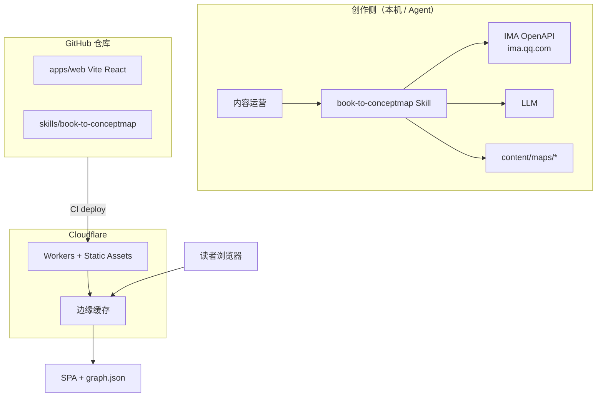
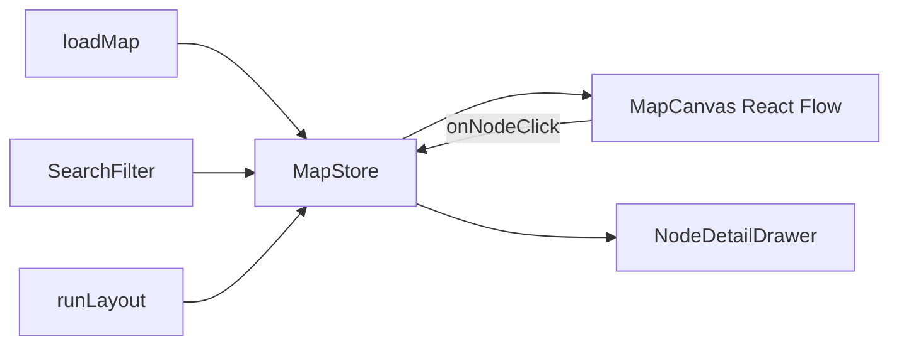

# 概念地图生成器 — 技术架构方案

> 版本：0.1  
> 日期：2026-10-09（CST）  
> 状态：推荐栈已选定，待确认开放问题后落地脚手架

---

## 1. 问题与目标（技术视角）

把「IMA 书本原文 → 结构化概念图 → 可部署 Web 阅读器」做成可维护工程：

- **内容**与**代码**同仓 Git 版本化；
- 前端静态 SPA，全球 CDN 分发；
- 抽取流水线以 Skill + 脚本形式复用，凭证不出 Agent 本机。

### 非目标（技术）

- 服务端长期存储用户会话数据；
- 在浏览器端调用 IMA OpenAPI（密钥不可下发）；
- 第一版不做 SSR SEO 优化（书名列表页可用预渲染二期再做）。

---

## 2. 推荐技术栈（明确选型，不骑墙）

| 层 | 选型 | 理由 |
|----|------|------|
| 前端框架 | **Vite + React 18+ + TypeScript** | 生态成熟、Cloudflare 官方 Vite 插件友好 |
| 图可视化 | **@xyflow/react（React Flow）** | 节点即 React 组件，详情卡片/中文排版/抽屉面板最自然；内置 MiniMap、Controls、Panel、Background |
| UI | **Tailwind CSS v4**（`@tailwindcss/vite`，CSS-first `@theme`；原语见 `apps/web/src/components/ui`） | 详情抽屉、筛选条实现快；token 化后主题切换与一致性成本低 |
| 布局算法 | **ELK**（`elkjs`）或 `@dagrejs/dagre` | 自动排版；首版 dagre 即可，复杂层次升级 ELK |
| 内容格式 | **JSON（graph）+ Markdown（说明）** 存于 `content/` | 与 Git Diff/PR 审校契合 |
| 抽取流水线 | **book-to-conceptmap Skill** + Node 脚本 + LLM | 复用已装 ima-skill 1.1.10 |
| 托管 | **Cloudflare Workers + Static Assets**（SPA 模式） | 平台当前推荐方向；静态资源免费、可同仓加 `/api` |
| 备选托管 | Cloudflare Pages | 纯静态 + Git 连接仍可用；与 Workers 能力接近 |
| CI | GitHub Actions → `wrangler deploy` 或 Cloudflare Git 集成 | |

> 样式与交互的具体规范（token 表、组件原语、断点、无障碍要求）见
> [03 · 视觉与交互规范](./03-visual-and-interaction-guidelines.md)。

### 为何不把 AntV X6 作为首选？

用户提到「Ant Design d6」应指 **AntV X6（@antv/x6）**。调研结论：

| 维度 | React Flow (@xyflow/react) | AntV X6 |
|------|----------------------------|---------|
| React 节点 | 一等公民（节点=组件） | 需 `@antv/x6-react-shape`，Portal 才能吃 Context |
| 开箱控件 | MiniMap / Controls / Panel | 插件丰富（对齐线、小地图、编辑扩展） |
| 典型场景 | 概念图、工作流、富节点卡片 | 流程图、BPMN、DAG、思维导图编辑器 |
| 中文生态 | 国际社区强 | AntV 中文文档与国内案例强 |
| 大图 | DOM 节点，约数百～一两千舒适 | 有虚拟渲染示例，编辑器向能力强 |
| 文档 | https://reactflow.dev/ | https://x6.antv.antgroup.com/ |

**本产品的核心 UX 是「点击节点 → React 详情面板 + 原文引用」**，React Flow 更贴合；X6 作为备选（若日后要重度在线编辑对齐线/锚点/BPMN 式编辑再评估迁移）。领域模型与渲染层解耦，切换成本可控。

参考链接：

- React Flow：https://reactflow.dev/ 、https://reactflow.dev/api-reference/components/minimap  
- X6：https://x6.antv.antgroup.com/en/tutorial/about 、https://x6.antv.antgroup.com/en/tutorial/intermediate/react  
- Cloudflare SPA：https://developers.cloudflare.com/workers/static-assets/routing/single-page-application/  
- JSON Graph 启发：https://github.com/jsongraph/json-graph-specification  

---

## 3. 系统架构总览



要点：

1. **IMA 与 LLM 只在创作侧运行**，永不进入浏览器。  
2. 构建时把 `content/maps/**/graph.json` 打进静态资源（或 `import.meta.glob`）。  
3. 读者请求不触达 IMA，无密钥泄露面。

---

## 4. Cloudflare 部署拓扑

### 4.1 采用：Cloudflare Pages（纯静态 SPA）

实际使用 **Pages**，配置在同仓 `apps/web/wrangler.toml`：

```toml
name = "concept-map-generator"
compatibility_date = "2026-10-09"
pages_build_output_dir = "./dist"
```

部署命令（见根 `package.json` 的 `deploy`）：

```bash
npm run build
npx --prefix apps/web wrangler pages deploy apps/web/dist --project-name concept-map-generator
```

行为：

- `/assets/*`、`/maps/*/graph.json` 等静态文件直出；
- 客户端路由（如 `/maps/foo`）回退 `index.html`（SPA）。

### 4.2 与 Workers + Static Assets 的取舍

| | Pages（当前采用） | Workers + Static Assets |
|--|------------------|-------------------------|
| 纯静态 SPA | 直接支持 `pages_build_output_dir` | 亦支持 |
| 未来 API / Cron | 需 Pages Functions 或迁 Workers | 同项目扩展 |
| 迁移成本 | — | 拓扑等价，可后续再迁 |

**结论**：当前用 **Pages**；若日后需要同项目 `/api`，再评估迁 Workers + Static Assets。

### 4.3 部署流水线


> 注意：`npm run build` 的 `prebuild` 会先跑 `build-index` + `sync-maps`，因此 `content/maps` 才是事实源，`apps/web/public/maps` 为生成物（已 gitignore，不入库）。

---

## 5. 仓库布局（实际）

```
concept-map-generator/                # 仓库根
├── apps/
│   └── web/                          # Vite + React + TS（部署产物 apps/web/dist）
│       ├── src/
│       │   ├── pages/                # HomePage / BookDetailPage / MapPage
│       │   ├── components/           # MapCanvas / DetailDrawer / PathGuide …
│       │   ├── lib/                  # graphUtils / layout(dagre) / fetchJson / covers
│       │   └── types/graph.ts
│       ├── public/maps/              # 由 sync-maps 生成，已 gitignore
│       ├── wrangler.toml             # Cloudflare Pages（pages_build_output_dir=./dist）
│       └── vite.config.ts
├── content/
│   └── maps/
│       ├── index.json                # 由 build-index.mjs 从各 meta.json 派生
│       └── <mapId>/                  # meta.json + graph.json
├── schemas/
│   └── graph.schema.json             # JSON Schema（Ajv 在 CI 校验）
├── scripts/
│   ├── build-index.mjs               # meta.json → index.json
│   ├── sync-maps.mjs                 # content/maps → apps/web/public/maps
│   └── validate-graph.mjs            # schema + 结构/质量校验
├── skills/
│   └── book-to-conceptmap/
│       ├── SKILL.md
│       └── scripts/fetch_and_extract.cjs   # 调 ima_api 下载 epub 并分章
├── docs/
├── .github/workflows/validate-graphs.yml
└── package.json                      # 脚本编排（build-index/sync-maps/validate/build/deploy）
```

与 **ima-skill** 关系：`book-to-conceptmap` **调用**已安装的 ima-skill（`~/agent-data/workflows/ima-skill/ima_api.cjs` + wiki API），不复制凭证逻辑。

---

## 6. 数据模型

### 6.1 `meta.json`

```json
{
  "id": "example-book",
  "title": "示例书名",
  "author": "作者",
  "language": "zh-CN",
  "status": "published",
  "version": "1.0.0",
  "schemaVersion": "1.1",
  "generatedAt": "2026-10-09T13:00:00+08:00",
  "source": {
    "file": "示例书名.epub",
    "kind": "epub",
    "imaKb": "我的书库",
    "mediaId": "<media_id>",
    "kbId": "<kb_id>",
    "mediaType": 21
  },
  "stats": { "nodes": 70, "edges": 108, "chapters": 28, "concepts": 38, "claims": 2, "persons": 1, "works": 1 },
  "nodeTypeBreakdown": { "chapter": 28, "concept": 38, "claim": 2, "person": 1, "work": 1 },
  "edgeTypeBreakdown": { "contains": 28, "related": 69, "contrasts": 9, "cites": 2 },
  "featuredPaths": []
}
```

- `version`：内容版本（每次重生成递增）；`schemaVersion` 固定 `"1.1"`。
- `source` 为来源信息的**唯一事实源**（不再有顶层 `ima` 字段）。
- `stats` / `nodeTypeBreakdown` / `edgeTypeBreakdown` 必须与 `graph.json` 实际计数一致（`npm run validate` 强制）。
- `index.json` 由 `scripts/build-index.mjs` 从各 `meta.json` 派生，禁止手改。


### 6.2 `graph.json`（核心）

```json
{
  "mapId": "example-book",
  "schemaVersion": "1.1",
  "nodes": [
    {
      "id": "c-queshi-pianwu",
      "type": "concept",
      "label": "确认偏误",
      "summary": "人们倾向于寻找支持已有信念的证据……（一句话定位）",
      "content": "基于原文的一段「详述」：展开概念在书中的论述层次，须与 summary、source.excerpt 都不同。",
      "source": {
        "chapter": "第三章",
        "file": "text00007.html",
        "excerpt": "……原文中逐字摘录的 2–4 句，可核对……",
        "anchor": "text00007.html"
      },
      "tags": ["概念"],
      "reviewStatus": "draft"
    },
    {
      "id": "ch-03",
      "type": "chapter",
      "label": "第三章",
      "summary": "章节锚点",
      "content": "本章导语（基于原文）。",
      "source": { "chapter": "第三章", "excerpt": "……本章正文开头 2–3 句……" }
    }
  ],
  "edges": [
    {
      "id": "e1",
      "source": "c-queshi-pianwu",
      "target": "ch-03",
      "type": "contains",
      "label": "收录"
    },
    {
      "id": "e2",
      "source": "c-queshi-pianwu",
      "target": "c-baochi-xinnian",
      "type": "related",
      "label": "相关",
      "description": "可选的边说明"
    }
  ]
}
```

节点/边模型（v1.1，`schemas/graph.schema.json` 为准）：

- 节点类型仅 5 种：`chapter` / `concept` / `claim` / `person` / `work`。
- 边类型仅 4 种：`related` / `contains` / `contrasts` / `cites`。
- 节点引用原文统一用 `source.{chapter,file,excerpt,anchor}`（**没有** `citations` / `chapterIds` / `position` / `aliases`）。
- `reviewStatus`（`draft`/`reviewed`）为作者流水线可选字段，**读者端不渲染**。
- 布局坐标不落盘，前端按 `dagre`/`ELK` 现算（ADR 5）。

校验：`scripts/validate-graph.mjs` 用 Ajv 保证 schema、`edge.source/target` 引用存在的 `node.id`，并额外检查重复 id、自环、类型枚举、`content==summary`、模板残句、摘录过短、`meta.stats` 与 `index` 一致性；CI 跑 `validate-graphs`。

### 6.3 前端视图模型映射

| 领域 | React Flow |
|------|------------|
| `node.id` | `Node.id` |
| `node.type` | 映射到 `nodeTypes` 自定义组件 |
| `node.label` / `summary` | `data` |
| `node.position` | `position`；缺省则跑 layout |
| `edge.*` | `Edge` + `type` 样式 |

---

## 7. 前端模块设计



关键交互：

1. 进入 `/maps/:mapId` → 加载 JSON → 若无 position 则 dagre/ELK → 渲染。  
2. 点击节点 → 选中态 + 打开 Drawer（展示 summary、citations、邻接表）。  
3. MiniMap + Controls 开箱即用。  
4. 深链 `/maps/:mapId?node=:nodeId`（可选 `?type=` / `?focus=` / `?q=` / `?edge=`）→ fitView 到该节点并打开详情。

中文：使用系统字体栈（`"PingFang SC", "Noto Sans SC", sans-serif`），节点内文本 `line-clamp`，避免撑破节点宽。

---

## 8. 抽取流水线与 Skill 技术细节

### 8.1 IMA 调用链（只读）

```
search_knowledge_base → 确认 KB
search_knowledge / get_knowledge_list → 定位 media_id
get_media_info →
  media_type=11 → notes get_doc_content
  否则 url_info.url (+ headers) → 本机下载
```

API Base：`https://ima.qq.com/openapi/wiki/v1`（见 ima-skill `knowledge-base/references/api.md`）。

### 8.2 分块策略（提议）

| 规则 | 值 |
|------|-----|
| 优先切分 | 章/节标题正则 |
| 回退 | 按 ~3000 汉字滑动窗口，重叠 ~200 字 |
| 块 ID | `ch{NN}-{seq}` |
| 缓存路径 | `.cache/ima/<mediaId>/`（gitignore） |

### 8.3 LLM 抽取契约

每块输入：`chunk text + 已有概念词典（标题列表）`  
每块输出：严格 JSON（nodes/edges/citations），`excerpt` 必须是原文子串或高相似度摘录。  
合并：按规范化 label（小写、去空白）合并节点；边按 `(source,target,type)` 去重。

### 8.4 失败策略

- IMA `code≠0`：展示 `msg`，停止。  
- `url_info` 空：提示「请使用 ima 客户端查看原文」，Skill 中止并记录。  
- 单块 LLM 失败：跳过并记入 `REVIEW.md`，不污染已成功块。

---

## 9. 安全与密钥

| 项 | 规则 |
|----|------|
| IMA Client ID / API Key | 仅 `~/.config/ima` 或环境变量；**禁止**进 Git / 前端 / Cloudflare secrets（读者路径不需要） |
| 原文缓存 | `.cache/` gitignore；勿提交整书版权文本若仓库公开——公开仓建议只提交**摘录级** citations |
| CORS | 静态同源；无浏览器调 IMA |

版权提示（产品/法务层面）：公开部署时默认只上线摘要 + 短摘录；完整原文留在 IMA。

---

## 10. 图库对比结论表

| 库 | 适合概念地图？ | 详情面板 | 中文标签 | 大规模 | Cloudflare SPA | 结论 |
|----|----------------|----------|----------|--------|----------------|------|
| **@xyflow/react** | ★★★★★ | 原生 React | 好 | 中（~1–2k） | 完美 | **首选** |
| **@antv/x6** | ★★★★ | 需 react-shape | 好（国内文档） | 中高 | 完美 | 备选（重编辑） |
| Cytoscape.js | ★★★ | 自建 DOM 叠加 | 可 | 高 | 完美 | 分析向备选 |
| Sigma.js | ★★ | 弱 | 需自研 | 很高（WebGL） | 完美 | 仅超大图 |
| vis-network | ★★★ | 弱 | 可 | 中 | 完美 | 快速原型 |
| Markmap | ★★ | 弱 | 好 | 低 | 完美 | 大纲树，非联想图 |
| LiteGraph / Rete | ★★ | 中 | 可 | 中 | 完美 | 视觉编程向，不贴合 |

---

## 11. 架构决策记录（ADR 摘要）

1. **内容静态化进仓**：读者零后端依赖，审校走 Git。  
2. **React Flow 而非 X6**：详情 UX 优先。  
3. **Workers Assets SPA**：顺应 Cloudflare 现状，预留 API。  
4. **Skill 依赖 ima-skill**：不重复造 OpenAPI 轮子。  
5. **领域 JSON ≠ 渲染 JSON**：`graph.json` 稳定；布局坐标可重算。

---

## 12. 实施里程碑（建议）

| 阶段 | 交付 |
|------|------|
| M0 | 空仓 + Vite 脚手架 + 样例 `graph.json` + 本地画布可点 |
| M1 | Cloudflare 部署通 + 深链节点 |
| M2 | `book-to-conceptmap` Skill 对一本真实书跑通草稿 |
| M3 | 人工审校规范 + Zod CI + 筛选/搜索 |
| M4 | （可选）Web 轻量编辑 / Cloudflare Access |

---

## 13. 开放问题 / 待决策

1. GitHub 仓库名称与是否 **public**？  
2. Cloudflare 账号与域名（`*.workers.dev` 或自定义）？  
3. 第一本试点书的知识库名 + 书名？  
4. 公开站点摘录长度上限（版权）？  
5. LLM 提供方（本机 Agent 自带 vs 显式 API）？  
6. 是否需要多书列表首页，还是单书单站？  
7. Web 在线编辑是否列入第一版？

---

## 附录 B：关键外部文档 URL

- React Flow：https://reactflow.dev/  
- AntV X6：https://x6.antv.antgroup.com/  
- X6 React 节点：https://x6.antv.antgroup.com/en/tutorial/intermediate/react  
- Cloudflare Workers Static Assets：https://developers.cloudflare.com/workers/static-assets/  
- Cloudflare SPA 路由：https://developers.cloudflare.com/workers/static-assets/routing/single-page-application/  
- JSON Graph Spec：https://github.com/jsongraph/json-graph-specification  
- IMA Agent 接口（凭证申请）：https://ima.qq.com/agent-interface  
